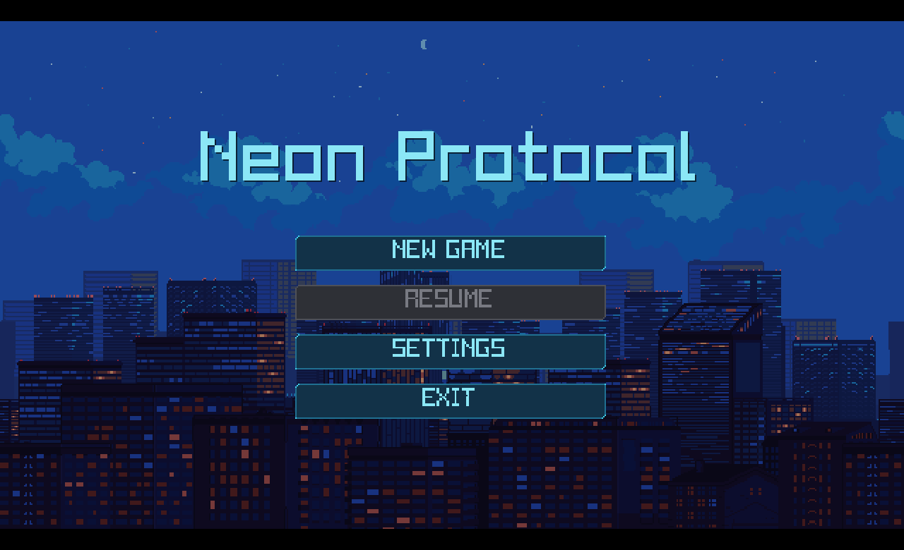

# Neon Protocol

A 2D top-down sci-fi survival shooter built with Godot 4.7.1 Mono (C# & GDScript).




## Tech Stack

- **Engine:** Godot 4.7.1 (Mono / .NET)
- **Languages:** C# (gameplay, HUD, pause, save/transition systems) & GDScript (UI, cutscenes, audio, settings)
- **Genre:** Top-down sci-fi shooter

## Features

### Campaign & Progression

- **Main Menu:** New Game, Resume (enabled when a valid checkpoint exists), Settings, and Exit.
- **5-Level Campaign (`Level_1` – `Level_5`):** Room-to-room progression with interactive security doors that unlock once enemies are defeated, culminating in a final Boss battle.
- **Narrative Cutscenes:** Introduction sequence (`IntroMessage` → `IntroCutScene`), mid-campaign story beats, post-climax recovery, award ceremony, and ending quotation sequence.
- **Checkpoint Save System:** Persistent save data (`user://savegame.json`) managed by `SaveManager` and `SceneTransition`, preserving level progress and crystal counts across sessions and clearing automatically upon campaign completion.

### Player & Combat

- Four-direction movement using WASD / arrow keys with directional idle and walking animations.
- Mouse-based weapon aiming with weapon flipping, per-direction attachment offsets, and aim-angle draw-order layering.
- Projectile firing with muzzle flash animation, health management, and crystal artifact inventory tracking.

### Enemies & Boss

- **Security Bots:** Four-directional spritesheet animations (`idle`, `move`, `attack`, `hurt`), finite state machine (`Chasing`, `Attacking`, `Hurt`, `Dead`), death smoke puff, and crystal artifact drops.
- **Boss Encounter:** Dedicated boss controller (`BossController.cs`) and laser attack (`BossLaser.cs`) in Level 5.

### UI, HUD & Settings

- **Gameplay HUD:** Sci-fi styled HUD (`cyan.tres` theme) featuring player health bar, crystal counter, and Game Over overlay.
- **Pause Menu:** Accessible in-game via `Esc` or `P` with **Resume**, **Settings**, **Back to Menu** (preserving valid checkpoints), and **Exit Game**.
- **Settings System:** Accessible from both the Main Menu and Pause Menu (`SettingsPanel.tscn` + `SettingsManager.gd`), persisted to `user://settings.cfg`:
  - **Audio:** Independent Music and Audio (`SFX`, `UI`, `Dialogue`) ON/OFF toggles and real-time 0–100% volume sliders.
  - **Display:** Immediate Fullscreen / Windowed mode switching and VSync ON/OFF toggle.

### Audio & Dialogue

- Centralized `AudioManager` autoload handling music tracks with smooth crossfades, UI hover/click feedback, gameplay SFX (shooting, enemy/boss deaths, door opening), and dialogue popup sounds.
- Typewriter dialogue reveal system (`Assets/dialogues/dialogue_reveal.gd`).

## Project Structure

```text
neon-protocol/
├── Assets/
│   ├── characters/          # Player, enemy, and boss spritesheets
│   ├── dialogues/           # Typewriter dialogue reveal system
│   ├── fx/                  # Muzzle flash, crystal, projectile, and smoke sprites
│   ├── interior/            # Tilemap textures (floors, walls, frames, doors)
│   ├── music/               # Background music tracks
│   ├── projectiles/         # Projectile and laser assets
│   ├── props/               # Environment props
│   └── SFX/                 # Gameplay, UI, and dialogue sound effects
├── Scenes/
│   ├── Autoload/            # AudioManager.tscn
│   ├── collectibles/        # Crystal_Artifact.tscn
│   ├── Cutscenes/           # Intro, Level, Post-Climax, Award, Ending, and SceneTransition scenes
│   ├── Levels/              # Level_1.tscn through Level_5.tscn
│   ├── UI/                  # main_menu.tscn, PauseMenu.tscn, SettingsPanel.tscn
│   ├── Boss.tscn            # Boss scene
│   ├── BossLaser.tscn       # Boss laser attack scene
│   ├── Door.tscn            # Interactive security door scene
│   ├── Enemy.tscn           # Enemy scene
│   ├── Player.tscn          # Player scene
│   └── Projectile.tscn      # Projectile scene
├── Scripts/                 # C# gameplay/system controllers & GDScript UI/cutscene/audio scripts
├── addons/pixel_ui_scifi/   # Pixel sci-fi UI theme and assets
├── default_bus_layout.tres  # Master, Music, SFX, UI, and Dialogue audio buses
└── project.godot            # Godot project and autoload configuration
```

## Controls

| Input              | Action                         |
| ------------------ | ------------------------------ |
| W / Up Arrow       | Move up                        |
| S / Down Arrow     | Move down                      |
| A / Left Arrow     | Move left                      |
| D / Right Arrow    | Move right                     |
| Mouse              | Aim weapon                     |
| Left Mouse / Space | Shoot                          |
| Esc / P            | Pause / Resume (or close menu) |

## Building

Requires the .NET SDK compatible with Godot 4.7.1.

```bash
dotnet build
```

## Asset Attribution

All third-party assets, audio, fonts, and textures are credited in [ATTRIBUTION.md](ATTRIBUTION.md).

## License

This project uses MIT License. Refer [LICENSE](LICENSE) for more details.
