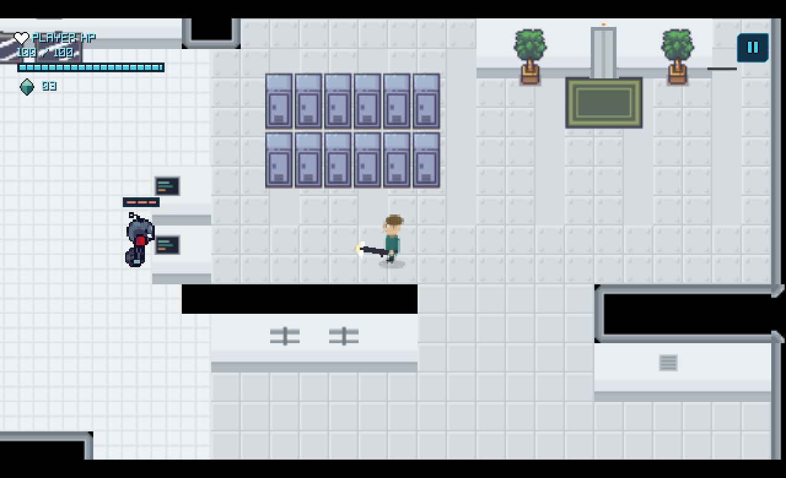

# Neon Protocol

A 2D top-down sci-fi survival shooter built with Godot 4.7.1 Mono and C#.



## Tech Stack

- **Engine:** Godot 4.7.1 (Mono / .NET)
- **Language:** C#
- **Genre:** Top-down shooter

## Features

### Player

- Four-direction movement using WASD / arrow keys
- Directional idle and walking animations
- Mouse-based weapon aiming with weapon flipping
- Weapon attachment system with per-direction offsets
- Weapon draw-order layering based on aim angle
- Muzzle flash animation on shooting
- Projectile firing with correct visual orientation
- Health management and damage receiving
- Crystal artifact collection and inventory tracking

### Enemy

- Enemy scene with four-directional spritesheet animations (idle, move, attack, hurt)
- Finite state machine: Chasing, Attacking, Hurt, and Dead states
- Dynamic attack tracking with player disengagement when out of range
- Hurt feedback and death animation (smoke puff)
- Death reward spawning with crystal artifact drop and defeat signals

### Collectibles & Progression

- Spinning Crystal Artifact with area pickup detection and anti-duplication protection
- Animated security door with physical collision barrier that unlocks on enemy defeat
- Level coordinator managing room progression from enemy defeat to door unlocking

### Heads-Up Display (HUD)

- Sci-fi styled HUD powered by custom theme
- Player health bar with heart indicator and exact value display
- Dynamic Security Bot health tracking (visible during combat)
- Two-digit crystal artifact counter
- Game Over screen overlay on player death

## Project Structure

```
neon-protocol/
├── Assets/
│   ├── characters/          # Player and enemy spritesheets
│   ├── fx/                  # Muzzle flash, crystal, projectile, and smoke sprites
│   └── interior/            # Tilemap textures (floors, walls, frames, doors)
├── Scenes/
│   ├── collectibles/        # Collectible scenes (Crystal_Artifact.tscn)
│   ├── Door.tscn            # Interactive door scene
│   ├── Enemy.tscn           # Enemy scene
│   ├── Player.tscn          # Player scene
│   ├── Projectile.tscn      # Projectile scene
│   └── main.tscn            # Main game arena scene
├── Scripts/
│   ├── CrystalArtifact.cs   # Collectible pickup logic
│   ├── DoorController.cs    # Door unlock animations and collision management
│   ├── EnemyController.cs   # Enemy AI, combat state machine, and death drops
│   ├── HUD.cs               # HUD manager for health bars, counter, and game over
│   ├── LevelController.cs   # Level-progression coordinator (defeat -> unlock)
│   ├── PlayerController.cs  # Player input, movement, aiming, health, and shooting
│   └── Projectile.cs        # Projectile movement and damage collision
└── project.godot            # Godot project configuration
```

## Controls

| Input          | Action     |
| -------------- | ---------- |
| W / Up Arrow   | Move up    |
| S / Down Arrow | Move down  |
| A / Left Arrow | Move left  |
| D / Right Arrow| Move right |
| Left Mouse / Space | Shoot  |
| Mouse          | Aim weapon |

## Scene Hierarchy (main.tscn)

```
NeonArena
├── Environment
│   ├── GroundLayer
│   ├── WallLayer
│   ├── FrameLayer
│   ├── DecorationLayer
│   └── Door
├── Actors
│   ├── Player
│   └── Enemy
├── Gameplay
│   └── LevelController
└── UI
    └── HUD
```

## Building

Requires the .NET SDK compatible with Godot 4.7.1.

```bash
dotnet build
```
