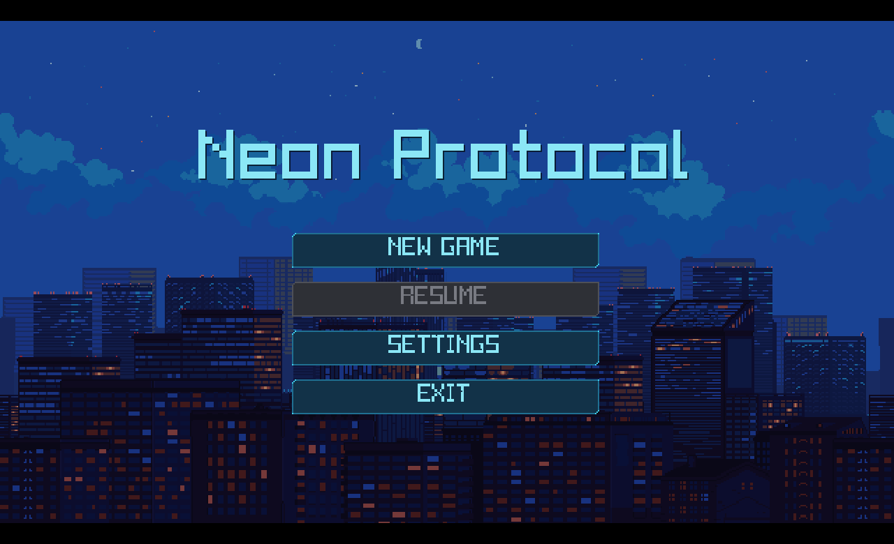
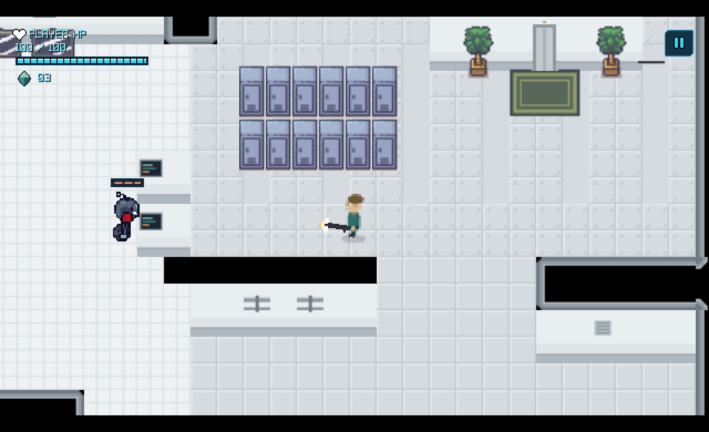

# नियॉन प्रोटोकॉल (Neon Protocol)

[English](../README.md) | [தமிழ்](README_TA.md) | [简体中文](README_ZH.md) | हिंदी | [Bahasa Indonesia](README_ID.md) | [Русский](README_RU.md)

Godot 4.7.1 Mono (C# और GDScript) द्वारा निर्मित एक 2D टॉप-डाउन साइंस-फिक्शन (sci-fi) सर्वाइवल शूटर गेम।




## टेक स्टैक (Tech Stack)

- **गेम इंजन:** Godot 4.7.1 (Mono / .NET)
- **प्रोग्रामिंग भाषाएं:** C# (गेमप्ले, HUD, पॉज़, सेव और सीन ट्रांज़िशन सिस्टम) और GDScript (UI, कटसीन, ऑडियो, सेटिंग्स)
- **शैली (Genre):** टॉप-डाउन साइंस-फिक्शन शूटर (Top-down sci-fi shooter)

## प्रमुख विशेषताएं (Features)

### अभियान और प्रगति (Campaign & Progression)

- **मुख्य मेनू (Main Menu):** नया गेम (New Game), जारी रखें (Resume - वैध चेकपॉइंट उपलब्ध होने पर ही सक्रिय), सेटिंग्स (Settings), और बाहर निकलें (Exit)।
- **5-स्तरीय अभियान (`Level_1` – `Level_5`):** कमरे-दर-कमरे आगे बढ़ने की प्रगति प्रणाली; दुश्मनों को हराने पर अनलॉक होने वाले इंटरैक्टिव सुरक्षा द्वार, और अंत में एक निर्णायक बॉस (Boss) मुकाबला।
- **कथात्मक कटसीन (Narrative Cutscenes):** परिचयात्मक क्रम (`IntroMessage` → `IntroCutScene`), अभियान के मध्य के कहानी बिंदु, चरम युद्ध के बाद की रिकवरी, पुरस्कार समारोह, और समापन उद्धरण दृश्य।
- **चेकपॉइंट सेव सिस्टम (Checkpoint Save System):** `SaveManager` और `SceneTransition` द्वारा प्रबंधित स्थायी सेव डेटा (`user://savegame.json`); यह विभिन्न गेम सत्रों के दौरान स्तर की प्रगति और क्रिस्टल की संख्या को सुरक्षित रखता है, तथा अभियान पूरा होने पर स्वतः साफ़ हो जाता है।

### खिलाड़ी और युद्ध प्रणाली (Player & Combat)

- WASD / तीर कुंजियों (arrow keys) का उपयोग करके चार दिशाओं में मूवमेंट, साथ ही दिशा-आधारित निष्क्रिय (idle) और चलने के एनिमेशन।
- माउस-आधारित हथियार निशाना साधना (aiming), हथियार पलटना (flipping), प्रत्येक दिशा के अनुसार अटैचमेंट ऑफसेट, और निशाने के कोण के आधार पर लेयरिंग क्रम।
- मज़ल फ्लैश एनिमेशन के साथ गोलियां दागना, स्वास्थ्य (हेल्थ) प्रबंधन, और एकत्र किए गए क्रिस्टल आर्टिफैक्ट्स की गिनती का ट्रैक रखना।

### दुश्मन और बॉस (Enemies & Boss)

- **सुरक्षा बॉट्स (Security Bots):** चार दिशाओं के स्प्राइटशीट एनिमेशन (`idle`, `move`, `attack`, `hurt`), परिमित अवस्था तंत्र (Finite State Machine: `Chasing`, `Attacking`, `Hurt`, `Dead`), मृत्यु पर धुएं का गुबार और क्रिस्टल आर्टिफैक्ट की गिरावट।
- **बॉस मुकाबला (Boss Encounter):** लेवल 5 में समर्पित बॉस कंट्रोलर (`BossController.cs`) और शक्तिशाली लेजर हमला (`BossLaser.cs`)।

### यूआई, HUD और सेटिंग्स (UI, HUD & Settings)

- **गेमप्ले HUD:** `cyan.tres` थीम पर आधारित साइंस-फिक्शन शैली का HUD, जिसमें खिलाड़ी का हेल्थ बार, क्रिस्टल काउंटर, और गेम ओवर स्क्रीन शामिल हैं।
- **पॉज़ मेनू (Pause Menu):** गेम के दौरान `Esc` या `P` दबाकर उपलब्ध; इसमें **जारी रखें (Resume)**, **सेटिंग्स (Settings)**, **मुख्य मेनू पर वापस जाएं (Back to Menu** - वैध चेकपॉइंट को सुरक्षित रखते हुए), और **गेम से बाहर निकलें (Exit Game)** शामिल हैं।
- **सेटिंग्स प्रणाली (Settings System):** मुख्य मेनू और पॉज़ मेनू दोनों से आसानी से खोली जा सकती है (`SettingsPanel.tscn` + `SettingsManager.gd`), सेटिंग्स `user://settings.cfg` में सुरक्षित की जाती हैं:
  - **ऑडियो (Audio):** संगीत (Music) और ध्वनि प्रभावों (`SFX`, `UI`, `Dialogue`) के लिए स्वतंत्र ऑन/ऑफ टॉगल और 0–100% का रियल-टाइम वॉल्यूम स्लाइडर।
  - **डिस्प्ले (Display):** फुलस्क्रीन (Fullscreen) और विंडो मोड (Windowed) के बीच तुरंत स्विच करने की सुविधा और VSync ऑन/ऑफ टॉगल।

### ऑडियो और संवाद (Audio & Dialogue)

- केंद्रीकृत `AudioManager` ऑटोलोड, जो सहज फेड के साथ बैकग्राउंड संगीत, UI होवर/क्लिक ध्वनियां, गेमप्ले साउंड इफेक्ट्स (फायरिंग, दुश्मन/बॉस की मृत्यु, दरवाज़ा खुलना) और संवाद पॉप-अप ध्वनियों को प्रबंधित करता है।
- टाइपराइटर शैली का संवाद प्रकटीकरण सिस्टम (`Assets/dialogues/dialogue_reveal.gd`)।

## प्रोजेक्ट संरचना (Project Structure)

```text
neon-protocol/
├── Assets/
│   ├── characters/          # खिलाड़ी, दुश्मन और बॉस के स्प्राइटशीट
│   ├── dialogues/           # टाइपराइटर संवाद प्रकटीकरण प्रणाली
│   ├── fx/                  # मज़ल फ्लैश, क्रिस्टल, गोली और धुएं के प्रभाव
│   ├── interior/            # टाइलमैन टेक्सचर्स (फर्श, दीवारें, फ्रेम, दरवाजे)
│   ├── music/               # बैकग्राउंड म्यूजिक ट्रैक्स
│   ├── projectiles/         # गोलियां और लेजर संसाधन
│   ├── props/               # पर्यावरण सामग्री
│   └── SFX/                 # गेमप्ले, UI और संवाद ध्वनि प्रभाव
├── Scenes/
│   ├── Autoload/            # AudioManager.tscn
│   ├── collectibles/        # Crystal_Artifact.tscn
│   ├── Cutscenes/           # इंट्रो, लेवल, क्लाइमेक्स के बाद, अवार्ड, एंडिंग और SceneTransition दृश्य
│   ├── Levels/              # Level_1.tscn से Level_5.tscn तक
│   ├── UI/                  # main_menu.tscn, PauseMenu.tscn, SettingsPanel.tscn
│   ├── Boss.tscn            # बॉस सीन
│   ├── BossLaser.tscn       # बॉस लेजर अटैक सीन
│   ├── Door.tscn            # इंटरैक्टिव सुरक्षा द्वार सीन
│   ├── Enemy.tscn           # दुश्मन सीन
│   ├── Player.tscn          # खिलाड़ी सीन
│   └── Projectile.tscn      # गोली/प्रोजेक्टाइल सीन
├── Scripts/                 # C# गेमप्ले/सिस्टम कंट्रोलर्स और GDScript UI/कटसीन/ऑडियो स्क्रिप्ट्स
├── addons/pixel_ui_scifi/   # पिक्सेल साइंस-फिक्शन UI थीम और एसेट्स
├── default_bus_layout.tres  # Master, Music, SFX, UI और Dialogue ऑडियो बसें
└── project.godot            # Godot प्रोजेक्ट और ऑटोलोड कॉन्फ़िगरेशन
```

## नियंत्रण (Controls)

| इनपुट (Input)        | क्रिया (Action)                           |
| ------------------- | ----------------------------------------- |
| W / ऊपर का तीर कुंजी | ऊपर जाएं                                  |
| S / नीचे का तीर कुंजी| नीचे जाएं                                 |
| A / बायां तीर कुंजी  | बाएं जाएं                                 |
| D / दायां तीर कुंजी  | दाएं जाएं                                 |
| माउस (Mouse)        | हथियार से निशाना साधें                    |
| बायां माउस / Space  | गोली चलाएं                                |
| Esc / P             | गेम पॉज़ / जारी रखें (या मेनू बंद करें)    |

## बिल्ड कैसे करें (Building)

Godot 4.7.1 के साथ संगत .NET SDK की आवश्यकता है।

```bash
dotnet build
```

## एसेट आभार और श्रेय (Asset Attribution)

सभी तृतीय-पक्ष एसेट्स, ऑडियो, फ़ॉन्ट्स और टेक्सचर्स का श्रेय [ATTRIBUTION.md](../ATTRIBUTION.md) में दिया गया है।

## लाइसेंस (License)

यह प्रोजेक्ट MIT लाइसेंस के तहत उपलब्ध है। अधिक जानकारी के लिए [LICENSE](../LICENSE) देखें।
