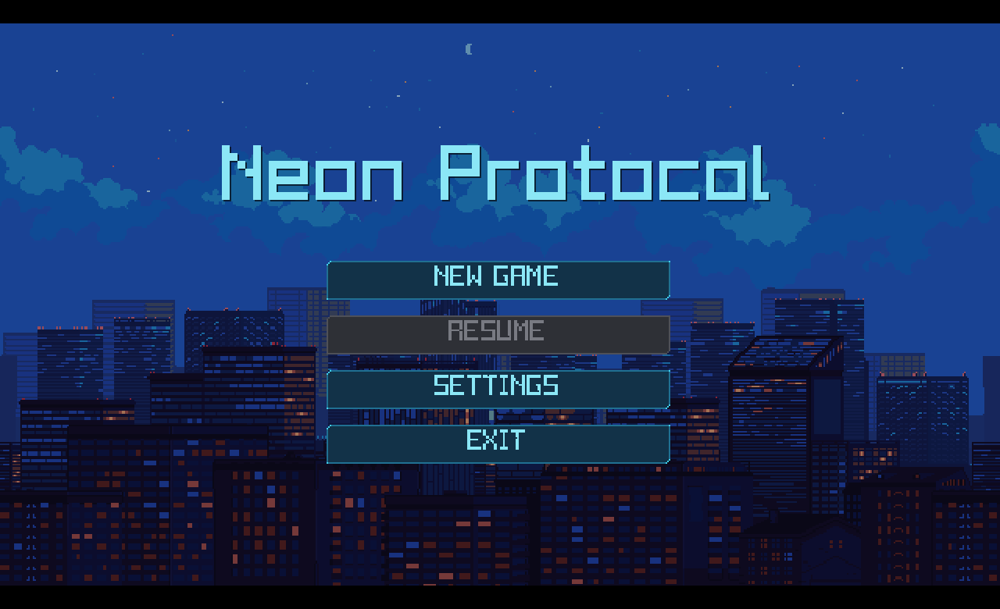
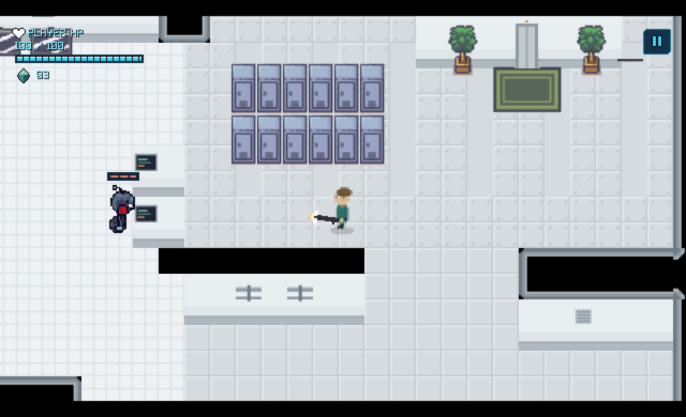

# Neon Protocol

[English](../README.md) | [தமிழ்](README_TA.md) | [简体中文](README_ZH.md) | [हिंदी](README_HI.md) | Bahasa Indonesia | [Русский](README_RU.md)

Sebuah game top-down sci-fi survival shooter 2D yang dibangun menggunakan Godot 4.7.1 Mono (C# & GDScript).




## Tech Stack

- **Engine:** Godot 4.7.1 (Mono / .NET)
- **Bahasa Pemrograman:** C# (gameplay, HUD, sistem pause, save/transisi) & GDScript (UI, cutscene, audio, pengaturan)
- **Genre:** Top-down sci-fi shooter

## Fitur Utama (Features)

### Kampanye & Progresi (Campaign & Progression)

- **Menu Utama (Main Menu):** Game Baru (New Game), Lanjutkan (Resume - aktif jika ada checkpoint yang valid), Pengaturan (Settings), dan Keluar (Exit).
- **Kampanye 5 Level (`Level_1` – `Level_5`):** Progresi bertahap dari ruangan ke ruangan dengan pintu keamanan interaktif yang terbuka setelah musuh dikalahkan, berpuncak pada pertarungan Boss terakhir.
- **Cutscene Naratif (Narrative Cutscenes):** Rangkaian cerita introduksi (`IntroMessage` → `IntroCutScene`), potongan cerita di tengah kampanye, pemulihan pasca-klimaks, upacara penghargaan, dan adegan kutipan penutup.
- **Sistem Simpan Checkpoint (Checkpoint Save System):** Data penyimpanan persisten (`user://savegame.json`) yang dikelola oleh `SaveManager` dan `SceneTransition`, menjaga progresi level dan jumlah kristal antar sesi permainan, serta dihapus secara otomatis setelah kampanye selesai.

### Pemain & Pertarungan (Player & Combat)

- Pergerakan empat arah menggunakan WASD / tombol panah, dilengkapi animasi idle dan berjalan sesuai arah.
- Membidik senjata berbasis kursor mouse dengan pembalikan senjata (weapon flipping), offset pemasangan per arah, dan layering urutan render berdasarkan sudut bidikan.
- Penembakan proyektil dengan animasi kilatan moncong (muzzle flash), pengelolaan health pemain, dan inventaris artefak kristal.

### Musuh & Boss (Enemies & Boss)

- **Robot Keamanan (Security Bots):** Animasi spritesheet empat arah (`idle`, `move`, `attack`, `hurt`), finite state machine (`Chasing`, `Attacking`, `Hurt`, `Dead`), efek asap saat hancur, dan drop artefak kristal.
- **Pertarungan Boss (Boss Encounter):** Pengontrol Boss khusus (`BossController.cs`) dan serangan laser mematikan (`BossLaser.cs`) di Level 5.

### UI, HUD & Pengaturan (UI, HUD & Settings)

- **HUD Gameplay:** HUD bertema fiksi ilmiah (`cyan.tres`) yang menampilkan bilah health pemain, penghitung kristal, dan overlay Game Over.
- **Menu Pause (Pause Menu):** Dapat diakses saat bermain menggunakan tombol `Esc` atau `P`, menyediakan opsi **Lanjutkan (Resume)**, **Pengaturan (Settings)**, **Kembali ke Menu (Back to Menu** - tetap menjaga checkpoint yang valid), dan **Keluar Game (Exit Game)**.
- **Sistem Pengaturan (Settings System):** Dapat diakses dari Menu Utama maupun Menu Pause (`SettingsPanel.tscn` + `SettingsManager.gd`), disimpan secara persisten di `user://settings.cfg`:
  - **Audio:** Tombol sakelar ON/OFF terpisah untuk Musik dan Audio (`SFX`, `UI`, `Dialogue`), serta slider volume real-time 0–100%.
  - **Tampilan (Display):** Pengalihan instan antara mode Layar Penuh (Fullscreen) / Jendela (Windowed), dan sakelar VSync ON/OFF.

### Audio & Dialog (Audio & Dialogue)

- Autoload `AudioManager` terpusat yang menangani transisi musik halus (crossfade), audio interaksi UI (hover/klik), efek suara gameplay (tembakan, musuh/boss hancur, pintu terbuka), dan suara popup dialog.
- Sistem dialog dengan kemunculan teks bertahap ala mesin tik (`Assets/dialogues/dialogue_reveal.gd`).

## Struktur Proyek (Project Structure)

```text
neon-protocol/
├── Assets/
│   ├── characters/          # Spritesheet pemain, musuh, dan boss
│   ├── dialogues/           # Sistem dialog animasi teks mesin tik
│   ├── fx/                  # Efek kilatan moncong, kristal, proyektil, dan asap
│   ├── interior/            # Tekstur tilemap (lantai, dinding, bingkai, pintu)
│   ├── music/               # Trek musik latar
│   ├── projectiles/         # Aset proyektil dan laser
│   ├── props/               # Properti dekorasi lingkungan
│   └── SFX/                 # Efek suara gameplay, UI, dan dialog
├── Scenes/
│   ├── Autoload/            # AudioManager.tscn
│   ├── collectibles/        # Crystal_Artifact.tscn
│   ├── Cutscenes/           # Adegan intro, level, pasca-klimaks, penghargaan, ending, dan SceneTransition
│   ├── Levels/              # Level_1.tscn hingga Level_5.tscn
│   ├── UI/                  # main_menu.tscn, PauseMenu.tscn, SettingsPanel.tscn
│   ├── Boss.tscn            # Adegan Boss
│   ├── BossLaser.tscn       # Adegan serangan laser Boss
│   ├── Door.tscn            # Adegan pintu keamanan interaktif
│   ├── Enemy.tscn           # Adegan musuh
│   ├── Player.tscn          # Adegan pemain
│   └── Projectile.tscn      # Adegan proyektil peluru
├── Scripts/                 # Script gameplay/sistem C# & script UI/cutscene/audio GDScript
├── addons/pixel_ui_scifi/   # Tema UI pixel sci-fi dan aset pendukung
├── default_bus_layout.tres  # Bus audio Master, Music, SFX, UI, dan Dialogue
└── project.godot            # Konfigurasi proyek Godot dan autoload
```

## Kontrol Permainan (Controls)

| Tombol / Input     | Aksi                                      |
| ------------------ | ----------------------------------------- |
| W / Panah Atas     | Bergerak ke atas                          |
| S / Panah Bawah    | Bergerak ke bawah                         |
| A / Panah Kiri     | Bergerak ke kiri                          |
| D / Panah Kanan    | Bergerak ke kanan                         |
| Mouse              | Membidik senjata                          |
| Klik Kiri / Spasi  | Menembak                                  |
| Esc / P            | Jeda / Lanjutkan (atau menutup menu aktif)|

## Kompilasi & Build (Building)

Memerlukan .NET SDK yang kompatibel dengan Godot 4.7.1.

```bash
dotnet build
```

## Atribusi Aset (Asset Attribution)

Semua aset pihak ketiga, audio, font, dan tekstur dicantumkan dalam [ATTRIBUTION.md](../ATTRIBUTION.md).

## Lisensi (License)

Proyek ini dilisensikan di bawah Lisensi MIT. Lihat [LICENSE](../LICENSE) untuk informasi lebih lanjut.
