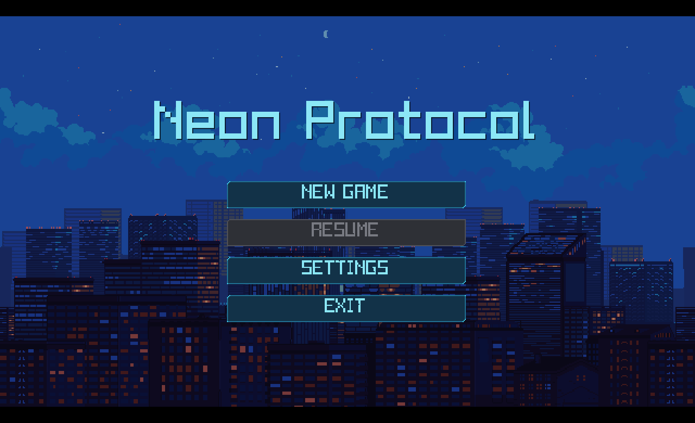
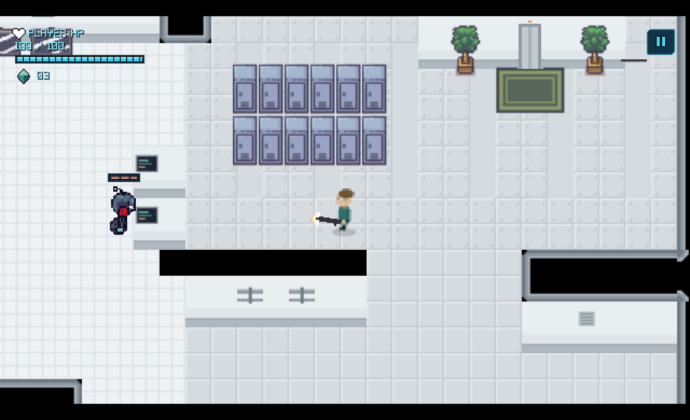

# Neon Protocol (Неон Протокол)

[English](../README.md) | [தமிழ்](README_TA.md) | [简体中文](README_ZH.md) | [हिंदी](README_HI.md) | [Bahasa Indonesia](README_ID.md) | Русский

2D научно-фантастический шутер с видом сверху (top-down survival shooter), разработанный на движке Godot 4.7.1 Mono (C# и GDScript).




## Стек технологий (Tech Stack)

- **Движок:** Godot 4.7.1 (Mono / .NET)
- **Языки разработки:** C# (геймплей, HUD, пауза, системы сохранений и переходов) и GDScript (UI, кат-сцены, звук, настройки)
- **Жанр:** Научно-фантастический шутер с видом сверху (Top-down sci-fi shooter)

## Особенности игры (Features)

### Кампания и прохождение (Campaign & Progression)

- **Главное меню (Main Menu):** Новая игра (New Game), Продолжить (Resume — доступно при наличии актуальной контрольной точки), Настройки (Settings) и Выход (Exit).
- **Кампания из 5 уровней (`Level_1` – `Level_5`):** Пошаговое продвижение из комнаты в комнату с интерактивными защитными дверями, открывающимися после зачистки врагов, с кульминационной финальной битвой с Боссом.
- **Сюжетные кат-сцены (Narrative Cutscenes):** Вступительный пролог (`IntroMessage` → `IntroCutScene`), промежуточные сюжетные повороты, спасение после кульминации, церемония награждения и финальный экран с эпилогом-цитатой.
- **Система контрольных точек (Checkpoint Save System):** Постоянное сохранение данных (`user://savegame.json`), управляемое `SaveManager` и `SceneTransition`; сохраняет текущий уровень и собранные кристаллы между игровыми сессиями и автоматически удаляется после полного завершения кампании.

### Игрок и боевая система (Player & Combat)

- Передвижение в четырех направлениях с помощью клавиш WASD / стрелок, с анимациями ходьбы и ожидания для каждого направления.
- Прицеливание оружием с помощью мыши, отражение спрайта оружия (weapon flipping), индивидуальные смещения точки крепления и динамическая сортировка слоев отрисовки в зависимости от угла прицеливания.
- Стрельба снарядами с анимацией дульной вспышки, система учета здоровья и сбор артефактов-кристаллов в инвентарь.

### Враги и Босс (Enemies & Boss)

- **Охранные дроны/боты (Security Bots):** Четырехсторонние анимации спрайтов (`idle`, `move`, `attack`, `hurt`), конечный автомат состояний (Finite State Machine: `Chasing`, `Attacking`, `Hurt`, `Dead`), эффект облака дыма при гибели и выпадение кристаллов.
- **Битва с Боссом (Boss Encounter):** Специализированный контроллер босса (`BossController.cs`) и мощная лазерная атака (`BossLaser.cs`) на 5-м уровне.

### Интерфейс, HUD и настройки (UI, HUD & Settings)

- **Боевой интерфейс (HUD):** Выполнен в неоново-кибернетическом стиле темы `cyan.tres`; отображает шкалу здоровья игрока, счетчик кристаллов и оверлей Game Over при гибели.
- **Меню паузы (Pause Menu):** Вызывается во время игры клавишей `Esc` или `P`, содержит пункты **Продолжить (Resume)**, **Настройки (Settings)**, **Главное меню (Back to Menu** — с сохранением контрольной точки) и **Выход из игры (Exit Game)**.
- **Система настроек (Settings System):** Доступна как из главного меню, так и из меню паузы (`SettingsPanel.tscn` + `SettingsManager.gd`), сохраняется в `user://settings.cfg`:
  - **Аудио:** Независимые переключатели ВКЛ/ВЫКЛ для музыки и эффектов (`SFX`, `UI`, `Dialogue`), а также плавные ползунки громкости от 0 до 100%.
  - **Экран:** Мгновенное переключение между полноэкранным (Fullscreen) и оконным (Windowed) режимами, а также переключатель вертикальной синхронизации (VSync).

### Звук и диалоги (Audio & Dialogue)

- Централизованный автозагружаемый `AudioManager`, обеспечивающий плавное переключение треков (кроссфейд), отклик UI (наведение/клик), звуковые эффекты геймплея (выстрелы, взрывы врагов и босса, открытие дверей) и звуки всплывающих реплик.
- Система диалогов с эффектом печатной машинки (`Assets/dialogues/dialogue_reveal.gd`).

## Структура проекта (Project Structure)

```text
neon-protocol/
├── Assets/
│   ├── characters/          # Спрайты персонажа, врагов и босса
│   ├── dialogues/           # Система вывода диалогов в стиле печатной машинки
│   ├── fx/                  # Спрайты вспышек, кристаллов, снарядов и дыма
│   ├── interior/            # Текстуры тайлмапов (полы, стены, рамы, двери)
│   ├── music/               # Фоновые музыкальные треки
│   ├── projectiles/         # Ресурсы снарядов и лазера
│   ├── props/               # Декорации и объекты окружения
│   └── SFX/                 # Звуковые эффекты геймплея, интерфейса и диалогов
├── Scenes/
│   ├── Autoload/            # AudioManager.tscn
│   ├── collectibles/        # Crystal_Artifact.tscn
│   ├── Cutscenes/           # Сцены пролога, уровней, финала, наград и SceneTransition
│   ├── Levels/              # Сцены с Level_1.tscn по Level_5.tscn
│   ├── UI/                  # main_menu.tscn, PauseMenu.tscn, SettingsPanel.tscn
│   ├── Boss.tscn            # Сцена босса
│   ├── BossLaser.tscn       # Сцена лазерной атаки босса
│   ├── Door.tscn            # Интерактивная защитная дверь
│   ├── Enemy.tscn           # Сцена врага
│   ├── Player.tscn          # Сцена игрока
│   └── Projectile.tscn      # Сцена пули/снаряда
├── Scripts/                 # C# скрипты геймплея/систем и GDScript скрипты интерфейса/аудио
├── addons/pixel_ui_scifi/   # Пиксельная научно-фантастическая UI тема и ресурсы
├── default_bus_layout.tres  # Аудиошины Master, Music, SFX, UI и Dialogue
└── project.godot            # Конфигурация проекта Godot и автозагрузки
```

## Управление (Controls)

| Клавиша / Ввод     | Действие                                         |
| ------------------ | ------------------------------------------------ |
| W / Стрелка вверх  | Движение вверх                                   |
| S / Стрелка вниз   | Движение вниз                                    |
| A / Стрелка влево  | Движение влево                                   |
| D / Стрелка вправо | Движение вправо                                  |
| Мышь               | Прицеливание                                     |
| ЛКМ / Пробел       | Стрельба                                         |
| Esc / P            | Пауза / Продолжить (или закрыть открытое меню)   |

## Сборка проекта (Building)

Требуется .NET SDK, совместимый с Godot 4.7.1.

```bash
dotnet build
```

## Использованные ресурсы (Asset Attribution)

Все сторонние графические ресурсы, музыка, звуки и шрифты указаны в файле [ATTRIBUTION.md](../ATTRIBUTION.md).

## Лицензия (License)

Проект распространяется под лицензией MIT. Подробности см. в файле [LICENSE](../LICENSE).
