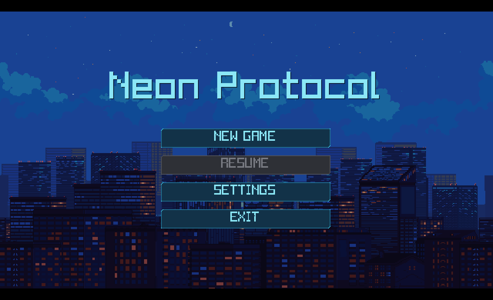
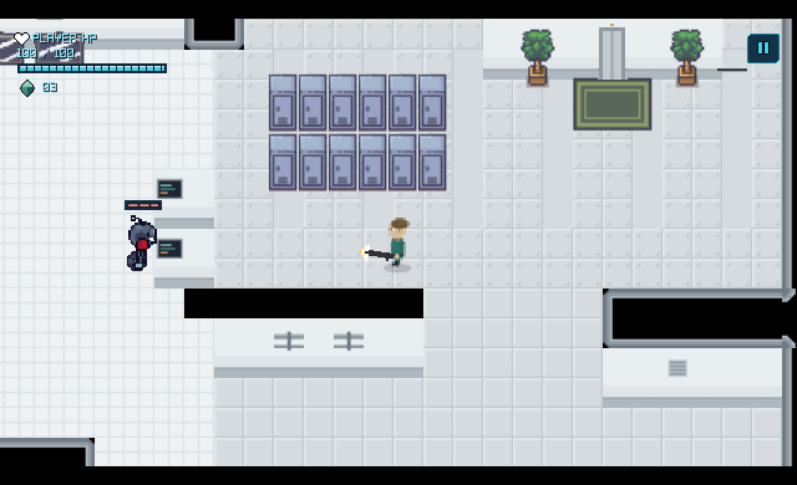

# நியான் புரோட்டோகால் (Neon Protocol)

[English](../README.md) | தமிழ் | [简体中文](README_ZH.md) | [हिंदी](README_HI.md) | [Bahasa Indonesia](README_ID.md) | [Русский](README_RU.md)

Godot 4.7.1 Mono (C# & GDScript) கொண்டு உருவாக்கப்பட்ட 2D டாப்-டவுன் அறிவியல் புனைகதை (sci-fi) சர்வைவல் ஷூட்டர் விளையாட்டு.




## தொழில்நுட்ப அடுக்கு (Tech Stack)

- **இன்ஜின் (Engine):** Godot 4.7.1 (Mono / .NET)
- **மொழிகள் (Languages):** C# (Gameplay, HUD, இடைநிறுத்தம், சேமிப்பு/காட்சி மாற்ற அமைப்புகள்) & GDScript (UI, காட்சிக் கதைகள், ஆடியோ, அமைப்புகள்)
- **வகை (Genre):** டாப்-டவுன் சயின்ஸ்-ஃபை ஷூட்டர் (Top-down sci-fi shooter)

## சிறப்பம்சங்கள் (Features)

### கதைப் பிரச்சாரம் & முன்னேற்றம் (Campaign & Progression)

- **முதன்மை மெனு (Main Menu):** புதிய விளையாட்டு (New Game), தொடர்க (Resume - செல்லுபடியாகும் சோதனைச் சாவடி இருக்கும்போது செயல்படும்), அமைப்புகள் (Settings) மற்றும் வெளியேறு (Exit).
- **5-நிலை பிரச்சாரம் (`Level_1` – `Level_5`):** அறையிலிருந்து அறைக்கு நகரும் முன்னேற்றம்; எதிரிகளை வீழ்த்தியதும் திறக்கப்படும் ஊடாடும் பாதுகாப்பு கதவுகள், இறுதியாக இறுதி பாஸ் (Boss) போருடன் நிறைவடைகிறது.
- **கதை சொல்லும் காட்சிக் கதைகள் (Narrative Cutscenes):** அறிமுகக் காட்சிகள் (`IntroMessage` → `IntroCutScene`), பிரச்சாரத்தின் இடைப்பட்ட கதை நிகழ்வுகள், கிளைமாக்ஸுக்குப் பிந்தைய மீட்சி, விருது வழங்கும் விழா மற்றும் இறுதி மேற்கோள் காட்சிகள்.
- **செக்பாயிண்ட் சேமிப்பு முறை (Checkpoint Save System):** `SaveManager` மற்றும் `SceneTransition` மூலம் நிர்வகிக்கப்படும் நிலையான சேமிப்புத் தரவு (`user://savegame.json`); இது நிலையின் முன்னேற்றத்தையும் படிகங்களின் எண்ணிக்கையையும் அமர்வுகளுக்கிடையே பாதுகாக்கிறது, பிரச்சாரம் முழுமையாக முடிந்தவுடன் தானாகவே நீக்கப்படுகிறது.

### பிளேயர் & போர்முறை (Player & Combat)

- WASD / அம்பு விசைகளைப் பயன்படுத்தி நான்கு திசைகளிலும் நகர்தல், மற்றும் திசைசார் நின்ற நிலை (idle) மற்றும் நடை அனிமேஷன்கள்.
- மவுஸ் அடிப்படையிலான துப்பாக்கி குறிபார்த்தல், துப்பாக்கி திருப்புதல் (flipping), திசைக்கேற்ப இணைக்கும் ஆஃப்செட்கள் மற்றும் குறிபார்த்தல் கோணத்தின் அடிப்படையில் அடுக்குகளை வரைதல்.
- மஸ்ஸில் ஃபிளாஷ் (muzzle flash) அனிமேஷனுடன் குண்டுகளைச் சுடுதல், ஆரோக்கிய மேலாண்மை மற்றும் சேகரிக்கப்பட்ட கிரிஸ்டல் கலைப்பொருட்களின் இருப்பைக் கண்காணித்தல்.

### எதிரிகள் & பாஸ் (Enemies & Boss)

- **பாதுகாப்பு ரோபோக்கள் (Security Bots):** நான்கு திசை ஸ்ப்ரைட்ஷீட் அனிமேஷன்கள் (`idle`, `move`, `attack`, `hurt`), வரையறுக்கப்பட்ட நிலைக் கட்டுப்பாட்டு அமைப்பு (`Chasing`, `Attacking`, `Hurt`, `Dead`), இறப்பின் போது தோன்றும் புகை மூட்டம் மற்றும் கிரிஸ்டல் கலைப்பொருள் பரிசுகள்.
- **பாஸ் போர் (Boss Encounter):** நிலை 5-ல் பிரத்யேக பாஸ் கன்ட்ரோலர் (`BossController.cs`) மற்றும் லேசர் தாக்குதல் (`BossLaser.cs`).

### பயனர் இடைமுகம், HUD & அமைப்புகள் (UI, HUD & Settings)

- **கேம்பிளே HUD:** தனிப்பயன் தீம் (`cyan.tres`) கொண்டு வடிவமைக்கப்பட்ட சயின்ஸ்-ஃபை HUD; இதில் பிளேயரின் ஆரோக்கியப் பட்டை, கிரிஸ்டல் கவுண்டர் மற்றும் கேம் ஓவர் திரை ஆகியவை அடங்கும்.
- **இடைநிறுத்த மெனு (Pause Menu):** விளையாட்டின் போது `Esc` அல்லது `P` விசையை அழுத்தி அணுகலாம்; இதில் **தொடர்க (Resume)**, **அமைப்புகள் (Settings)**, **மெனுவிற்குத் திரும்பு (Back to Menu** - சரியான செக்பாயிண்ட்டைப் பாதுகாக்கும்) மற்றும் **விளையாட்டிலிருந்து வெளியேறு (Exit Game)** ஆகியவை உள்ளன.
- **அமைப்புகள் அமைப்பு (Settings System):** முதன்மை மெனு மற்றும் இடைநிறுத்த மெனு இரண்டிலிருந்தும் அணுகலாம் (`SettingsPanel.tscn` + `SettingsManager.gd`), அமைப்புகள் `user://settings.cfg` கோப்பில் சேமிக்கப்படுகின்றன:
  - **ஆடியோ (Audio):** இசை (Music) மற்றும் பிற ஒலிகளுக்கான (`SFX`, `UI`, `Dialogue`) தனித்தனி ஆன்/ஆஃப் நிலைகள் மற்றும் நிகழ்நேர 0–100% ஒலி ஸ்லைடர்கள்.
  - **திரை (Display):** முழுத்திரை (Fullscreen) / சாளர முறை (Windowed) உடனடி மாற்றம் மற்றும் VSync ஆன்/ஆஃப் நிலை.

### ஆடியோ & உரையாடல் (Audio & Dialogue)

- மையப்படுத்தப்பட்ட `AudioManager` ஆட்டோலோட்; இது மென்மையான மாற்றங்களுடன் பின்னணி இசை, UI சுட்டெலி நகர்வு/கிளிக் ஒலிகள், கேம்பிளே ஒலி விளைவுகள் (சுடுதல், எதிரி/பாஸ் மரணம், கதவு திறப்பு) மற்றும் உரையாடல் பாப்-அப் ஒலிகளைக் கையாள்கிறது.
- தட்டச்சுப்பொறி பாணியிலான உரையாடல் வெளிப்படுத்தும் அமைப்பு (`Assets/dialogues/dialogue_reveal.gd`).

## திட்டக் கட்டமைப்பு (Project Structure)

```text
neon-protocol/
├── Assets/
│   ├── characters/          # பிளேயர், எதிரி மற்றும் பாஸ் ஸ்ப்ரைட்ஷீட்கள்
│   ├── dialogues/           # தட்டச்சுப்பொறி உரையாடல் வெளிப்படுத்தும் அமைப்பு
│   ├── fx/                  # மஸ்ஸில் ஃபிளாஷ், படிகம், தோட்டா மற்றும் புகை ஸ்ப்ரைட்டுகள்
│   ├── interior/            # டைல்மேப் அமைப்புகள் (தரைகள், சுவர்கள், பிரேம்கள், கதவுகள்)
│   ├── music/               # பின்னணி இசைப் பாடல்கள்
│   ├── projectiles/         # தோட்டா மற்றும் லேசர் வளங்கள்
│   ├── props/               # சூழல் பொருட்கள்
│   └── SFX/                 # கேம்பிளே, UI மற்றும் உரையாடல் ஒலி விளைவுகள்
├── Scenes/
│   ├── Autoload/            # AudioManager.tscn
│   ├── collectibles/        # Crystal_Artifact.tscn
│   ├── Cutscenes/           # அறிமுகம், நிலை, உச்சக்கட்டத்திற்குப் பின், விருது, முடிவு மற்றும் SceneTransition காட்சிகள்
│   ├── Levels/              # Level_1.tscn முதல் Level_5.tscn வரை
│   ├── UI/                  # main_menu.tscn, PauseMenu.tscn, SettingsPanel.tscn
│   ├── Boss.tscn            # பாஸ் காட்சி
│   ├── BossLaser.tscn       # பாஸ் லேசர் தாக்குதல் காட்சி
│   ├── Door.tscn            # ஊடாடும் பாதுகாப்புக் கதவுக் காட்சி
│   ├── Enemy.tscn           # எதிரிக் காட்சி
│   ├── Player.tscn          # பிளேயர் காட்சி
│   └── Projectile.tscn      # தோட்டா காட்சி
├── Scripts/                 # C# கேம்பிளே/அமைப்புக் கன்ட்ரோலர்கள் & GDScript UI/காட்சிக் கதை/ஆடியோ ஸ்கிரிப்டுகள்
├── addons/pixel_ui_scifi/   # பிக்சல் சயின்ஸ்-ஃபை UI தீம் மற்றும் வளங்கள்
├── default_bus_layout.tres  # Master, Music, SFX, UI மற்றும் Dialogue ஆடியோ பஸ்கள்
└── project.godot            # Godot திட்ட மற்றும் ஆட்டோலோட் உள்ளமைவு
```

## கட்டுப்பாடுகள் (Controls)

| விசை (Input)       | செயல் (Action)                            |
| ------------------ | ---------------------------------------- |
| W / மேல் அம்பு விசை | மேலே நகர்தல்                             |
| S / கீழ் அம்பு விசை | கீழே நகர்தல்                             |
| A / இடது அம்பு விசை | இடதுபுறம் நகர்தல்                         |
| D / வலது அம்பு விசை | வலதுபுறம் நகர்தல்                         |
| மவுஸ் (Mouse)       | துப்பாக்கி குறிபார்த்தல்                  |
| இடது மவுஸ் / Space | சுடுதல்                                  |
| Esc / P            | இடைநிறுத்தம் / தொடர்க (அல்லது மூடு)       |

## உருவாக்கம் (Building)

Godot 4.7.1-க்கு இணக்கமான .NET SDK தேவைப்படுகிறது.

```bash
dotnet build
```

## சொத்துக்களின் உரிமம் மற்றும் பங்களிப்பு (Asset Attribution)

அனைத்து மூன்றாம் தரப்பு சொத்துக்கள், ஆடியோ, எழுத்துருக்கள் மற்றும் அமைப்புகளுக்கான விவரங்கள் [ATTRIBUTION.md](../ATTRIBUTION.md) கோப்பில் குறிப்பிடப்பட்டுள்ளன.

## உரிமம் (License)

இந்த திட்டம் MIT உரிமத்தின் கீழ் வெளியிடப்பட்டுள்ளது. கூடுதல் விவரங்களுக்கு [LICENSE](../LICENSE) கோப்பைப் பார்க்கவும்.
