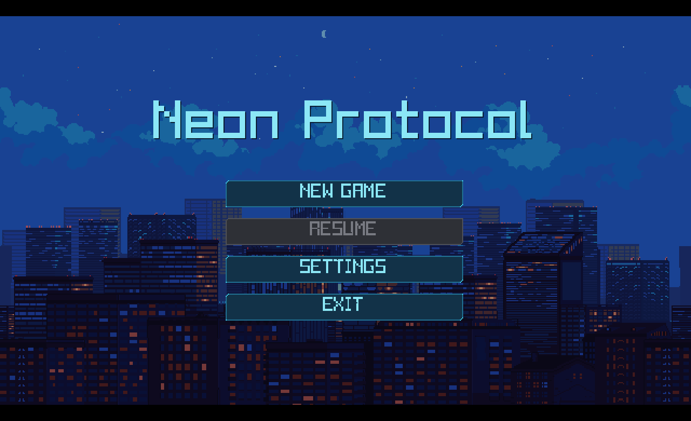
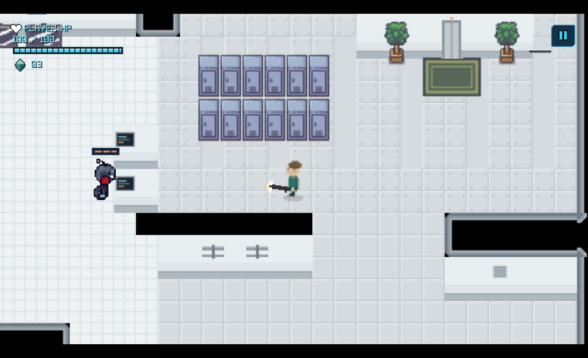

# 霓虹协议 (Neon Protocol)

[English](../README.md) | [தமிழ்](README_TA.md) | 简体中文 | [हिंदी](README_HI.md) | [Bahasa Indonesia](README_ID.md) | [Русский](README_RU.md)

基于 Godot 4.7.1 Mono（C# 与 GDScript）开发的 2D 自顶向下科幻生存射击游戏。




## 技术栈 (Tech Stack)

- **游戏引擎：** Godot 4.7.1 (Mono / .NET)
- **开发语言：** C#（核心玩法、HUD、暂停系统、存档与场景过渡）与 GDScript（UI、过场动画、音频控制、系统设置）
- **游戏类型：** 自顶向下科幻射击 (Top-down sci-fi shooter)

## 核心特性 (Features)

### 战役与关卡进度 (Campaign & Progression)

- **主菜单 (Main Menu)：** 开始新游戏 (New Game)、继续游戏 (Resume，仅在存在有效检查点存档时可用)、设置 (Settings) 以及退出游戏 (Exit)。
- **5 关完整战役 (`Level_1` – `Level_5`)：** 逐房间推进的关卡设计；击败所有守卫后解锁交互式安全门，最终迎接决战 Boss 考验。
- **叙事过场动画 (Narrative Cutscenes)：** 开篇剧情引导 (`IntroMessage` → `IntroCutScene`)、战役中途剧情、高潮决战后的救援苏醒、授勋仪式及终章引言画面。
- **检查点存档系统 (Checkpoint Save System)：** 由 `SaveManager` 与 `SceneTransition` 统一管理的本地持久化存档 (`user://savegame.json`)，支持跨会话保留关卡进度与水晶数量，并在战役通关后自动清理。

### 玩家与战斗系统 (Player & Combat)

- 支持 WASD / 方向键四向移动，配备对应朝向的待机与行走动画。
- 基于鼠标指向的精准武器瞄准，支持枪械翻转、各朝向枪口挂载偏移，并根据瞄准角度动态调整图层渲染顺序。
- 伴随枪口火焰动画的子弹发射机制、生命值管理系统与水晶神器收集背包计数。

### 敌人与 Boss 战 (Enemies & Boss)

- **防卫机器人 (Security Bots)：** 四方向序列帧动画（待机、移动、攻击、受击），有限状态机架构 (`Chasing`、`Attacking`、`Hurt`、`Dead`)，击败时的烟雾爆炸反馈及水晶掉落奖励。
- **首领决战 (Boss Encounter)：** 第 5 关专属 Boss 控制器 (`BossController.cs`) 与强力激光强袭技能 (`BossLaser.cs`)。

### 界面、HUD 与设置 (UI, HUD & Settings)

- **战术 HUD：** 采用 `cyan.tres` 像素科幻主题，直观呈现玩家生命值条、水晶收集计数器及阵亡结束遮罩。
- **暂停菜单 (Pause Menu)：** 游戏中随时按 `Esc` 或 `P` 键呼出，包含**继续游戏 (Resume)**、**设置 (Settings)**、**返回主菜单 (Back to Menu**，安全保留检查点) 与**退出游戏 (Exit Game)**。
- **设置系统 (Settings System)：** 可在主菜单与暂停菜单中无缝开启 (`SettingsPanel.tscn` + `SettingsManager.gd`)，配置自动保存至 `user://settings.cfg`：
  - **音频：** 独立控制的背景音乐 (Music) 与全局音效（`SFX`、`UI`、`Dialogue`）开/关切换，以及 0–100% 实时音量调节滑块。
  - **显示：** 全屏 (Fullscreen) 与窗口化 (Windowed) 模式即时切换，以及垂直同步 (VSync) 开/关。

### 音频与对话系统 (Audio & Dialogue)

- 集中式 `AudioManager` 自动加载单例，支持背景音乐平滑跨曲淡入淡出、UI 悬停/点击交互反馈、战斗音效（射击、敌人/Boss 阵亡、舱门开启）及对话提示音。
- 打字机风格文字渐现对话系统 (`Assets/dialogues/dialogue_reveal.gd`)。

## 项目结构 (Project Structure)

```text
neon-protocol/
├── Assets/
│   ├── characters/          # 玩家、敌人与 Boss 精灵图表
│   ├── dialogues/           # 打字机对话文字系统
│   ├── fx/                  # 枪口火焰、水晶、子弹与烟雾特效
│   ├── interior/            # 瓦片地图纹理（地板、墙壁、门框、安全门）
│   ├── music/               # 背景音乐音轨
│   ├── projectiles/         # 子弹与激光资源
│   ├── props/               # 场景装饰道具
│   └── SFX/                 # 战斗、UI 与对话音效
├── Scenes/
│   ├── Autoload/            # AudioManager.tscn
│   ├── collectibles/        # Crystal_Artifact.tscn
│   ├── Cutscenes/           # 序幕、关卡过渡、战后、授勋、尾声及 SceneTransition 场景
│   ├── Levels/              # Level_1.tscn 至 Level_5.tscn
│   ├── UI/                  # main_menu.tscn、PauseMenu.tscn、SettingsPanel.tscn
│   ├── Boss.tscn            # Boss 战场景
│   ├── BossLaser.tscn       # Boss 激光攻击场景
│   ├── Door.tscn            # 交互式安全门场景
│   ├── Enemy.tscn           # 敌人场景
│   ├── Player.tscn          # 玩家角色场景
│   └── Projectile.tscn      # 投射物子弹场景
├── Scripts/                 # C# 核心玩法控制器 & GDScript UI/过场/音频脚本
├── addons/pixel_ui_scifi/   # 像素科幻 UI 主题与资源
├── default_bus_layout.tres  # Master、Music、SFX、UI 与 Dialogue 音频总线
└── project.godot            # Godot 项目与 Autoload 配置文件
```

## 操作按键 (Controls)

| 输入按键           | 操作说明                       |
| ------------------ | ------------------------------ |
| W / 方向键上       | 向上移动                       |
| S / 方向键下       | 向下移动                       |
| A / 方向键左       | 向左移动                       |
| D / 方向键右       | 向右移动                       |
| 鼠标移动           | 瞄准武器                       |
| 鼠标左键 / 空格键  | 射击                           |
| Esc / P            | 暂停 / 继续游戏（或关闭当前菜单） |

## 编译与构建 (Building)

需要安装与 Godot 4.7.1 兼容的 .NET SDK。

```bash
dotnet build
```

## 素材归属与致谢 (Asset Attribution)

所有使用的第三方美术素材、音频、字体及贴图均已在 [ATTRIBUTION.md](../ATTRIBUTION.md) 中完整列出。

## 开源协议 (License)

本项目采用 MIT 许可证。详细条款请参阅 [LICENSE](../LICENSE)。
